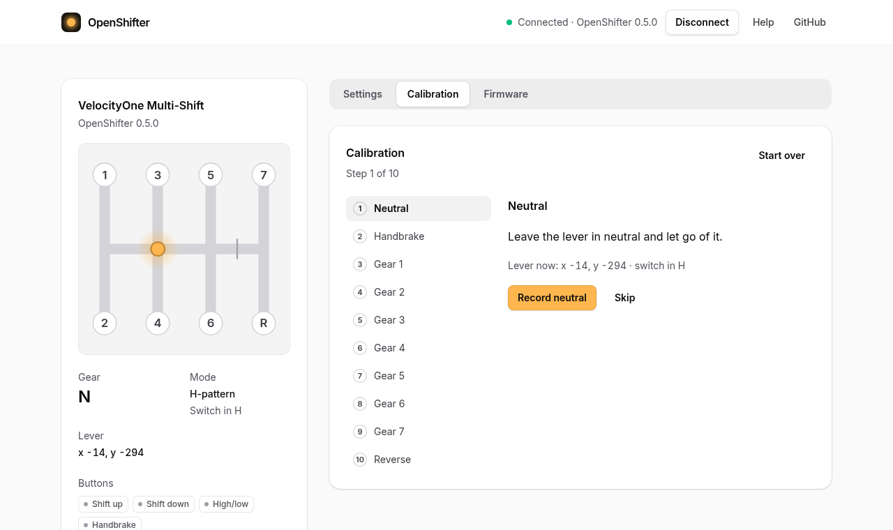

Calibrating teaches the shifter where neutral, the handbrake and each gear are. Do it after every install, or when a gear is detected wrong. It works with OpenShifter and with the stock firmware.

## Steps

1. Connect the shifter in the **[web tool](https://filipnone.github.io/OpenShifter/)** and open the **Calibration** tab.
2. Put the **H/SEQ switch** in **H** and press **Start calibration**.
3. For each step, move the lever as the page says, hold it still and press the **Record** button:

   | Step | Lever |
   |---|---|
   | Neutral | in neutral, hands off |
   | Handbrake | pulled fully back |
   | Gears 1 to 6 | in the gear |
   | Gear 7 and Reverse | pushed down to unlock, then in the gear |

4. **Unplug the shifter and plug it back in.** The calibration is already saved, but the shifter keeps adjusting the gears until it restarts.

**Skip** keeps a step as it was. **Back** goes to the previous step so you can record it again.

## Sequential thresholds (optional)

These set how far the lever has to move before a shift counts. Tick **Also set the sequential thresholds** before you press Start. Two steps are added after Handbrake:

| Step | Switch | Lever |
|---|---|---|
| Shift down | SEQ | pushed forward |
| Shift up | SEQ | pulled back |

Put the switch back in **H** for the gear steps. The page tells you when.
