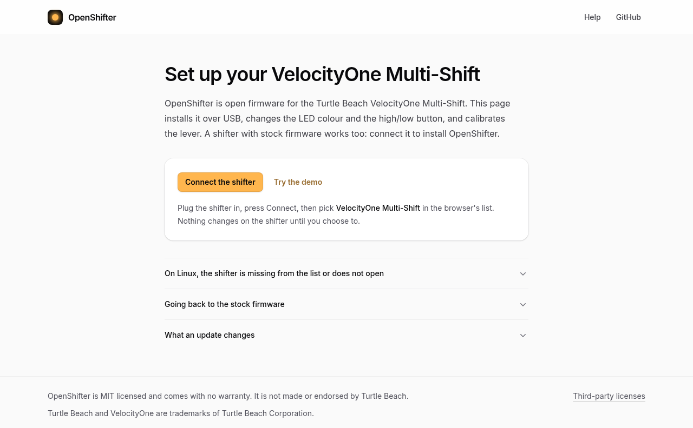

OpenShifter is free replacement firmware for the **Turtle Beach VelocityOne Multi-Shift**. You install it from your browser.

**[Open the web tool](https://filipnone.github.io/OpenShifter/)**

## What you get

- Choose the colour of the LEDs, and turn the logo LED on or off.
- Use the Handbrake button as a normal button while the switch is in H.
- Make the High/low button a toggle if you like.
- Get a neutral button, for games that stay in gear when you move the lever to neutral.
- On Linux, games find the shifter as a joystick with no extra driver.
- You can go back to the Turtle Beach firmware at any time.

## Set it up

| Step | Page |
|---|---|
| 1. Install OpenShifter | [Install](Install) |
| 2. Calibrate the lever | [Calibrate](Calibrate) |
| 3. Pick your colours (optional) | [Settings](Settings) |

Installing OpenShifter may void the shifter's warranty. It comes with no warranty of its own.

You need the shifter, its USB cable and a computer with **Chrome, Edge or Opera**. Safari and phones do not work. Firefox needs an add-on: see [Firefox](Firefox).

## More

- [Using the shifter](Using-the-shifter): modes, LEDs and the buttons games see
- [Troubleshooting](Troubleshooting)
- [Go back to stock](Go-back-to-stock)
- [Firefox](Firefox)
- [Command line (Linux)](Command-line)
