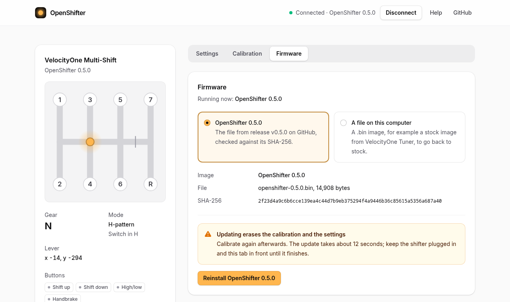

Installing OpenShifter replaces the shifter's firmware. It **erases your calibration and settings**, so you calibrate again afterwards.

Firmware that is not from Turtle Beach may void the shifter's warranty. OpenShifter comes with no warranty: you install it at your own risk.

## Before you start

- Use **Chrome, Edge or Opera** on a computer. Firmware updates do not work in Firefox, even with the [add-on](Firefox).
- Close **VelocityOne Tuner** if it is open.
- **Linux only:** give the browser access to the shifter. Run this once, then unplug the shifter and plug it back in:

  ```sh
  sudo tee /etc/udev/rules.d/70-openshifter.rules >/dev/null <<'EOF'
  SUBSYSTEM=="hidraw", ATTRS{idVendor}=="10f5", ATTRS{idProduct}=="7096", TAG+="uaccess"
  SUBSYSTEM=="hidraw", ATTRS{idVendor}=="10f5", ATTRS{idProduct}=="7097", TAG+="uaccess"
  EOF
  sudo udevadm control --reload-rules
  ```

## Steps

1. Plug in the shifter and open the **[web tool](https://filipnone.github.io/OpenShifter/)**.
2. Press **Connect the shifter**. In the browser's list, pick **VelocityOne Multi-Shift** and press **Connect**.
3. Open the **Firmware** tab. Leave the newest **OpenShifter** selected and press the install button below it.
4. Press **Erase and install**.
5. The LEDs turn yellow and the shifter restarts in update mode. The first time, the page asks for it again: press **Allow update mode**, pick **VelocityOne Multi-Shift** in the list and press **Connect**.
6. Wait. Keep the shifter plugged in and keep the tab open in front.
7. When the page says **OpenShifter** (and its version) **is running**, press **Calibrate now** and follow [Calibrate](Calibrate).



If the update stops halfway, the shifter waits in update mode. Connect it again and install again from the Firmware tab. See [Troubleshooting](Troubleshooting).

## Without the browser

On Linux you can also install from a terminal: see [Command line](Command-line). The firmware file is attached to each [release](https://github.com/FilipNone/OpenShifter/releases).
