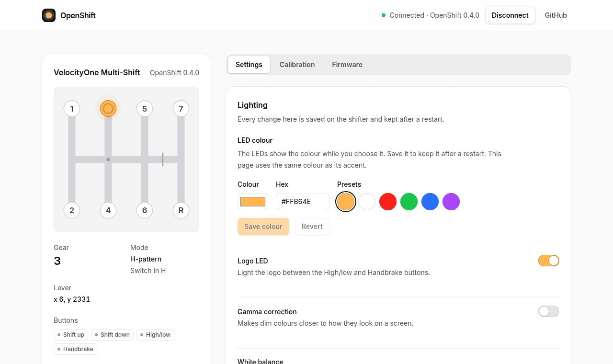

Open the **Settings** tab in the **[web tool](https://filipnone.github.io/OpenShifter/)**. Settings are saved on the shifter and stay after you unplug it. Installing firmware resets them to the defaults.

Settings need OpenShift. With the stock firmware, [install OpenShift](Install) first.

| Setting | What it does | Default |
|---|---|---|
| LED colour | Colour of the button LEDs and the logo. Pick a preset or type a colour such as `#FFB64E`, then press **Save colour**. | Warm orange |
| Logo LED | Lights the logo between the High/low and Handbrake buttons. Saved when you flip the switch. | Off |
| Gamma correction | Makes dim colours look closer to how they look on a screen. Saved when you flip the switch. | Off |
| White balance | Fixes LEDs that look blue or green when they should be white. Press **Adjust**, move the sliders until the LEDs look white, then press **Save white balance**. | Red 255, green 162, blue 96 |
| High/low button | **Button:** on while you hold it. **Toggle:** each press switches it on or off, and its LED shows red for off and green for on. Saved when you pick one. | Button |
| Neutral button | With the switch in H, presses the shifter's first button while the lever is out of gear. Turn it on if your game stays in the last gear when you move to neutral, then bind that button to **Neutral** in the game. See [Using the shifter](Using-the-shifter#what-games-see). Needs OpenShift 0.5.0. Saved when you flip the switch. | Off |
